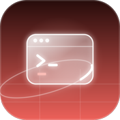

<!-- siso-os:header (generated by sisodias/siso-os-release from repos.json; edit there, not here) -->

  

<h1 align="center">Agent Zero</h1>

<b>The orchestrator: turns one person's words into tasks for a team of agents, checks what comes back and keeps the state.</b>

  
  
  
  

  

  <a href="https://www.sisolabs.space/agent-base/"><b>Website</b></a> · <a href="https://docs.sisolabs.space">Docs</a> · <a href="https://github.com/siso-os">Every SISO OS project</a>

<!-- /siso-os:header -->

## What it is

The orchestrator: turns one person's words into tasks for a team of agents, checks what comes back and keeps the state.

It is part of **Agent Base** in [SISO OS](https://github.com/siso-os), the open-source agent operating system we run SISO on. More on [the website](https://www.sisolabs.space/agent-base/).
